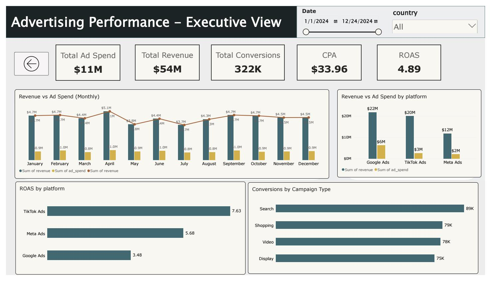
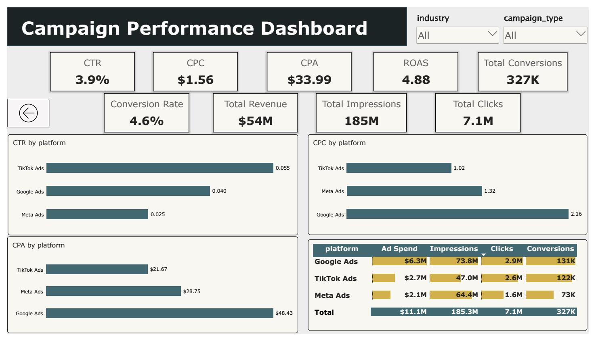

# 📊 Digital Advertising Performance Analysis

## 📌 Project Overview

This project focuses on analyzing digital advertising performance across multiple advertising platforms, campaign types, industries, and countries using Microsoft Power BI.

The main objective is to evaluate advertising effectiveness, measure campaign efficiency, compare market performance, and extract actionable insights that support data-driven marketing decisions.

---

## 🎯 Project Objectives

- 📈 Evaluate overall digital advertising performance.
- 📱 Compare advertising platforms and their efficiency.
- 🎯 Analyze campaign performance and conversion metrics.
- 🌍 Explore advertising performance across different countries.
- 🏢 Identify differences in performance between industries.
- 💡 Generate insights to support better marketing decisions.

---

## 🛠️ Tools & Technologies

-  Microsoft Power BI – Dashboard development and data visualization.
-  Power Query – Data preparation and transformation.
-  DAX – Creating calculated measures and performance metrics.

-  Exploratory Data Analysis (EDA) – Exploring patterns and trends.


## 📂 Dataset Description

The dataset contains approximately 2,000 records of digital advertising campaign data.

It includes the following fields:

| Column | Description |
|---|---|
| Date | Campaign date |
| Platform | Advertising platform |
| Campaign Type | Type of advertising campaign |
| Industry | Business industry |
| Country | Target market |
| Impressions | Number of ad impressions |
| Clicks | Number of clicks |
| CTR | Click-through rate |
| CPC | Cost per click |
| Ad Spend | Advertising expenditure |
| Conversions | Number of conversions |
| CPA | Cost per acquisition |
| Revenue | Revenue generated |
| ROAS | Return on advertising spend |

---

## Dashboard Structure
The project consists of four interactive pages (including a Home page for navigation):

### 1. Executive Overview
Provides a high-level overview of advertising performance.
- **Key Metrics:** Total Ad Spend ($11M), Total Revenue ($54M), Total Conversions (327K), CPA ($33.99), ROAS (4.88x).
- **Visualizations:** Monthly Revenue vs. Ad Spend (Dual Axis), Revenue and Ad Spend by Platform, ROAS by Platform, Conversions by Campaign Type.



### 2. Campaign Performance Analysis
Focuses on evaluating campaign and advertising platform efficiency.
- **Key Metrics:** CTR (3.9%), CPC ($1.56), CPA ($33.99), ROAS (4.88x), Conversion Rate (4.6%), Total Impressions (185M), Total Clicks (7.1M).
- **Visualizations:** CTR by Platform, CPC by Platform, CPA by Platform, Platform performance comparison matrix (with Data Bars).



### 3. Market & Industry Analysis
Explores differences in advertising performance across industries and geographic markets.
- **Visualizations:** Total Revenue by Industry, ROAS by Country, Total Ad Spend by Industry, Industry performance matrix (ROAS & Conversion Rate), Revenue vs. Ad Spend by Country (Scatter Plot).


## 💡 Key Insights

### 📱 Advertising Platform Performance

1. 🚀 TikTok Ads demonstrated the strongest advertising efficiency, recording the highest ROAS (7.63), highest CTR (5.5%), and the lowest CPC ($1.02) and CPA ($21.67).

2. 💰 Google Ads generated the highest revenue and conversion volume, with approximately $22M in revenue and 131K conversions. However, it also recorded the highest CPC ($2.16) and CPA ($48.43).

### 🎯 Campaign Performance

3. 🔍 Search campaigns generated the highest number of conversions, reaching approximately 89K, followed by Shopping (79K), Video (78K), and Display (75K).

### 🏢 Industry Analysis

4. 📈 SaaS was the highest-revenue industry, generating approximately $11.7M and 69K conversions.

5. 🏆 Healthcare recorded the highest conversion rate, at 4.753%, despite not having the highest conversion volum

6. ⚖️ Industry performance varied depending on the metric: SaaS led in revenue and conversion volume, while Healthcare led in conversion rate.

### 🌍 Market Analysis

7. 🇮🇳 India achieved the highest country-level ROAS, at 5.53, while the USA recorded the lowest among the analyzed countries, at 4.16.


## Key DAX Measures
The analysis utilizes robust DAX measures to calculate aggregated performance metrics, avoiding the pitfalls of averaging ratios:


#### CTR

```

CTR = DIVIDE([Total Clicks], [Total Impressions], 0)
```


#### CPC
```

CPC = DIVIDE([Total Ad Spend], [Total Clicks], 0)
```


#### CPA
```

CPA = DIVIDE([Total Ad Spend], [Total Conversions], 0)
```


#### ROAS
```

ROAS = DIVIDE([Total Revenue], [Total Ad Spend], 0)
```


#### Conversion Rate
```

Conversion Rate = DIVIDE([Total Conversions], [Total Clicks], 0)
```


## Conclusion
This project demonstrates the use of Power BI, data modeling, advanced DAX measures, and interactive visualizations to analyze digital advertising performance.
It highlights the importance of evaluating advertising campaigns using both revenue and efficiency metrics rather than relying on revenue alone, providing actionable insights for budget allocation and channel optimization.

#### Author: Ibrahim Hagrass
#### Project Type: Data Analytics / Power BI
#### Domain: Digital Marketing Analytics